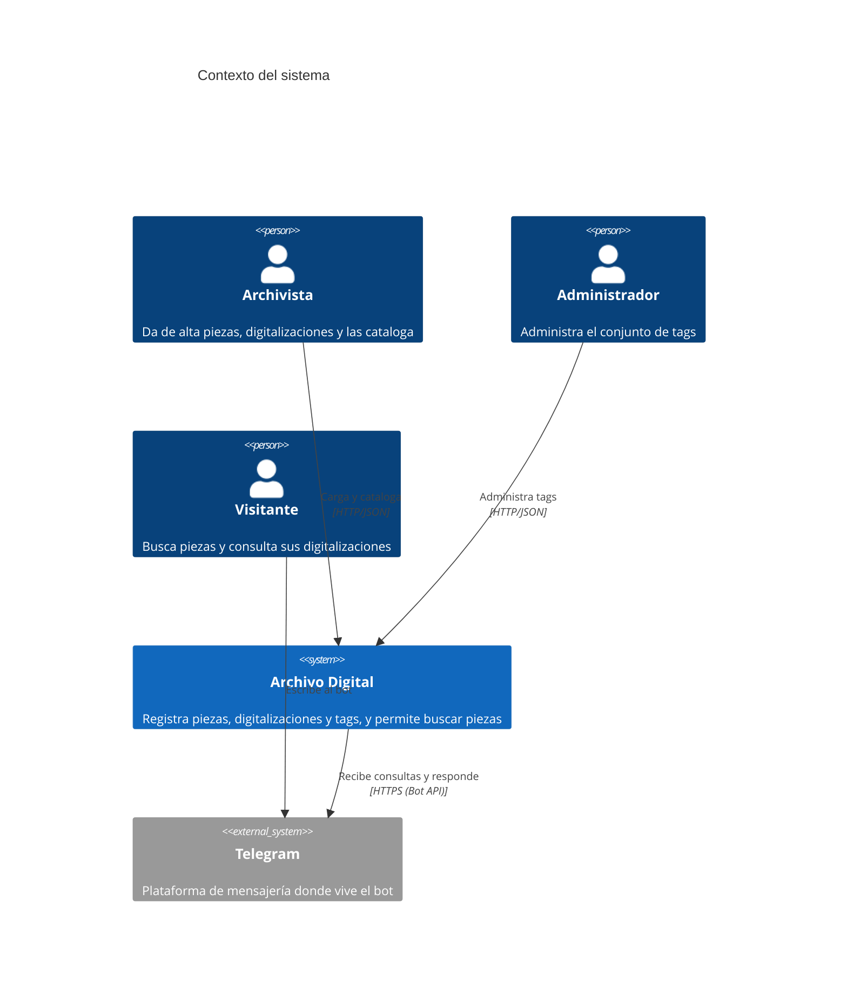
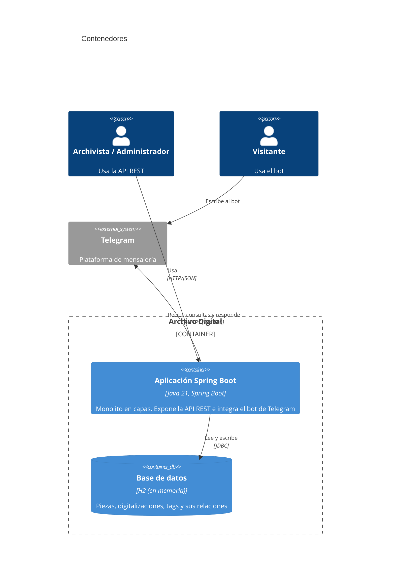
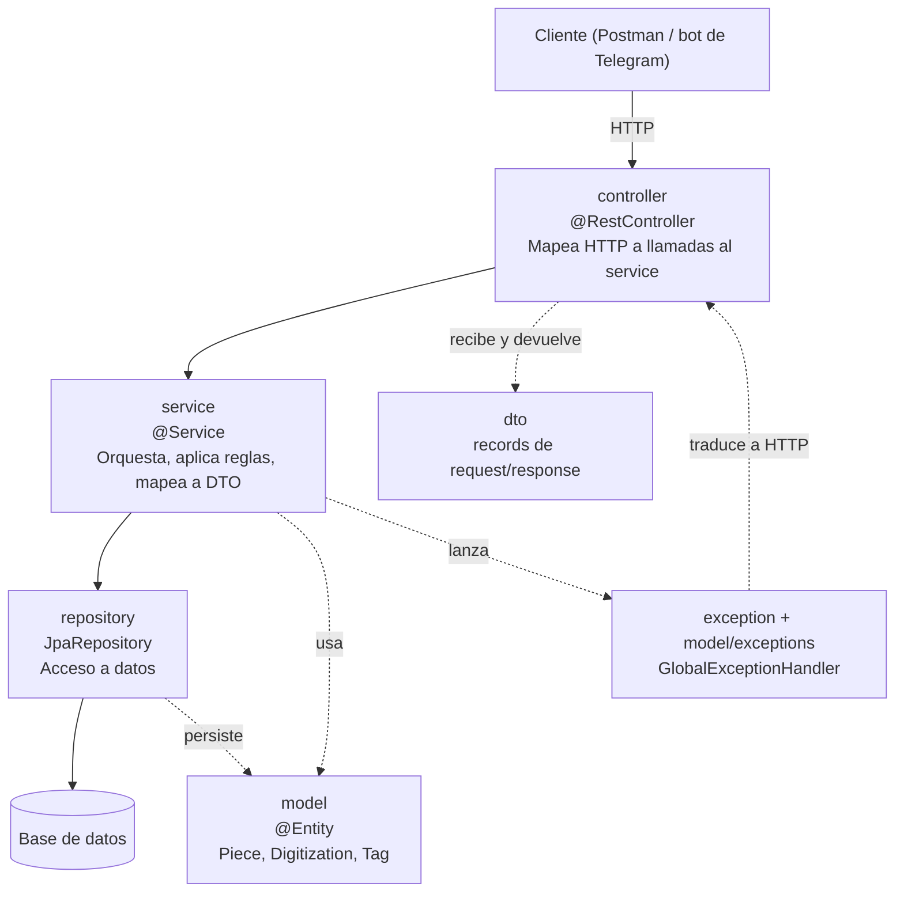
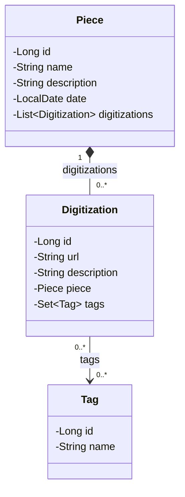
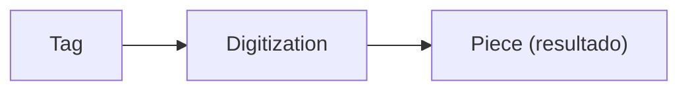

# ARCHITECTURE.md

Documento transversal (no cambia por feature/iteración). Complementa a `AGENTS.md`
(convenciones de código) con la descripción del dominio y la arquitectura general del sistema.

## 1. Descripción general

**Archivo Digital** es un sistema para registrar piezas o materiales físicos de un archivo, asociarles
sus digitalizaciones, catalogarlas con tags y ponerlas a disposición para búsquedas.

El proceso principal tiene cuatro etapas:

1. **Digitalización:** se da de alta la pieza física y se le asocian digitalizaciones. Cada
   digitalización es una URL a un recurso más una descripción.
2. **Catalogación:** se asignan tags a las digitalizaciones. Los tags no son libres: se eligen de un
   conjunto que un administrador puede modificar en tiempo de ejecución.
3. **Disponibilización:** se buscan piezas por fecha, nombre, descripción y tags. Se asume que habrá
   muchas piezas, por lo que los resultados se paginan.
4. **Visualización:** un bot de Telegram permite buscar y mostrar los resultados.

Se resuelve como un **monolito**: un único componente desplegable y una única base de datos.
Digitalización, Catalogación y Disponibilización se exponen como una API REST (sin pantallas).

## 2. Actores y sistemas

| Actor / sistema | Tipo            | Qué hace                                                               |
| --------------- | --------------- | ----------------------------------------------------------------------- |
| Archivista      | Persona         | Da de alta piezas, les agrega digitalizaciones y las cataloga con tags. |
| Administrador   | Persona         | Administra el conjunto de tags (crear, renombrar, eliminar).            |
| Visitante       | Persona         | Busca piezas y consulta sus digitalizaciones, desde el bot de Telegram. |
| Telegram        | Sistema externo | Plataforma de mensajería por la que el visitante conversa con el bot.  |

## 3. Alcance y fuera de alcance

**Dentro de alcance:**

- Alta y consulta de piezas, con listado paginado.
- Alta y consulta de digitalizaciones asociadas a una pieza.
- Administración de tags: crear, listar, renombrar y eliminar.
- Catalogación: asignar y quitar tags de una digitalización.
- Búsqueda de piezas por nombre, descripción, rango de fechas y tags.
- Bot de Telegram para buscar y ver el detalle de una pieza.
- API REST documentada y una secuencia de prueba del sistema completo.

**Fuera de alcance:**

- Pantallas o interfaz web.
- Autenticación y autorización. Los roles (archivista, administrador, visitante) describen
  actores del negocio, no usuarios del sistema.
- Almacenamiento de los archivos digitalizados: el sistema solo guarda la URL del recurso.
- Edición y baja de piezas y digitalizaciones.
- Búsqueda directa de digitalizaciones: la búsqueda siempre devuelve piezas.
- Extras opcionales del enunciado (OCR y etiquetado externo, carga por lote desde CSV, despliegue en
  Render), salvo que se decida incorporarlos.

## 4. Glosario de dominio

| Término                           | Significado                                                                                                  |
| ---------------------------------- | ------------------------------------------------------------------------------------------------------------ |
| Pieza (`Piece`)                  | Objeto o material físico del archivo. Tiene nombre, descripción opcional y fecha.                          |
| Digitalización (`Digitization`) | Representación digital de una pieza: una URL a un recurso y una descripción. Pertenece a una única pieza. |
| Tag (`Tag`)                      | Etiqueta de catalogación. Su nombre es único. Se elige de un conjunto administrado.                        |
| Catalogación                      | Acción de asociar tags a una digitalización.                                                               |
| Conjunto de tags                   | Tags existentes en el sistema. Solo el administrador lo modifica.                                            |
| Tag en uso                         | Tag asignado al menos a una digitalización. No puede eliminarse.                                            |
| Disponibilización                 | Puesta a disposición del archivo mediante búsquedas.                                                       |
| Fecha de la pieza                  | Fecha del objeto físico, cargada por el archivista (no la fecha de alta en el sistema).                     |

### Reglas de negocio

- El nombre de un tag es único y no puede estar vacío.
- No se puede eliminar un tag que está en uso.
- Una digitalización siempre pertenece a una pieza existente y requiere URL.
- Solo se pueden asignar a una digitalización tags que ya existen.
- Los tags se asignan a digitalizaciones, pero la búsqueda devuelve **piezas**: una pieza coincide
  con un tag si alguna de sus digitalizaciones lo tiene.
- Al buscar por varios tags, la pieza debe cumplir con **todos** ellos.

## 5. Vista C4 — Contexto (Nivel 1)

## 6. Vista C4 — Contenedores (Nivel 2)

### 6.1 Arquitectura en capas

El monolito sigue las capas de Fowler. Cada capa solo habla con la de abajo.

| Paquete              | Responsabilidad                                                               | No debe                                            |
| -------------------- | ----------------------------------------------------------------------------- | -------------------------------------------------- |
| `controller`       | Mapear HTTP a llamadas al service y validar la entrada (`@Valid`).          | Tener lógica de negocio ni acceder al repository. |
| `dto`              | Transportar datos de requests y responses (`record`).                       | Tener lógica. Nunca se devuelve una entidad JPA.  |
| `model`            | Entidades y reglas propias del dominio.                                       | Conocer HTTP.                                      |
| `model/exceptions` | Violaciones de reglas de negocio (`BusinessRuleException`).                 |                                                    |
| `exception`        | "No encontrado" (`ResourceNotFoundException`) y `GlobalExceptionHandler`. |                                                    |
| `repository`       | Acceso a datos con Spring Data JPA.                                           | Tener reglas de negocio.                           |
| `service`          | Buscar entidades, aplicar reglas, persistir y mapear a DTO.                   | Conocer HTTP.                                      |

### 6.2 Manejo de errores

El service lanza una excepción, esta sube hasta el controller y el `GlobalExceptionHandler` la
traduce a una respuesta con el código HTTP correspondiente.

| Excepción                                                | Origen               | HTTP |
| --------------------------------------------------------- | -------------------- | ---- |
| `ResourceNotFoundException`                             | `exception`        | 404  |
| `BusinessRuleException`                                 | `model/exceptions` | 409  |
| `MethodArgumentNotValidException` (validación del DTO) | Spring               | 400  |

El cuerpo de error es `{"error": "mensaje"}`.

## 7. Diagrama de clases de dominio

Cómo se mapea a la base de datos:

- `Piece` ↔ `Digitization` es **1 a N**. La clave foránea `piece_id` está en `digitizations`, por eso
  `Digitization` es el lado dueño de la relación. En `Piece`, `mappedBy = "piece"` marca el lado inverso.
- `Digitization` ↔ `Tag` es **N a M**. Se resuelve con la tabla intermedia `digitization_tags`
  (`digitization_id`, `tag_id`).
- `Piece` tiene `cascade = ALL` y `orphanRemoval = true` sobre sus digitalizaciones: se guardan y se
  borran junto con la pieza.
- `Tag` no conoce a las digitalizaciones. Para saber si está en uso se consulta desde `TagRepository`.

Tablas resultantes:

| Tabla                 | Columnas principales                                |
| --------------------- | --------------------------------------------------- |
| `pieces`            | `id`, `name`, `description`, `piece_date`   |
| `digitizations`     | `id`, `url`, `description`, `piece_id` (FK) |
| `tags`              | `id`, `name` (único)                           |
| `digitization_tags` | `digitization_id` (FK), `tag_id` (FK)           |

La columna `piece_date` evita llamar `date` a una columna, nombre que coincide con un tipo de dato SQL.

### Búsqueda de piezas a través de los tags

Los tags están en las digitalizaciones, pero la búsqueda devuelve piezas. La consulta recorre
`Tag → Digitization → Piece`:

## 8. Preguntas abiertas / próximos pasos

**Preguntas abiertas**

- Confirmar con los docentes que `Piece.date` es la fecha del objeto físico cargada a mano.
- Definir cómo se integra el bot de Telegram (consulta periódica o webhook) y si convive en el
  mismo proceso del monolito. El diagrama de contenedores asume que sí.
- Definir si las búsquedas aceptan filtros combinados (nombre, descripción, fechas y tags a la vez).

**Próximos pasos**

- [ ] Mergear las partes de Tags, Piezas/Digitalizaciones y Búsqueda.
- [ ] Documentar la API en `docs/api.md`.
- [ ] Armar los diagramas de base de datos y de secuencia en `docs/`.
- [ ] Implementar el bot de Telegram.
- [ ] Actualizar este documento si el diseño cambia durante la implementación.

## 9. Referencias

- Convenciones de código: [`AGENTS.md`](AGENTS.md).
- Historias de usuario: [`US.md`](US.md).
- Backlog y reparto: [`Backlog.md`](Backlog.md).
- Forma de trabajo del equipo: [`GUIA_EQUIPO.md`](GUIA_EQUIPO.md).
