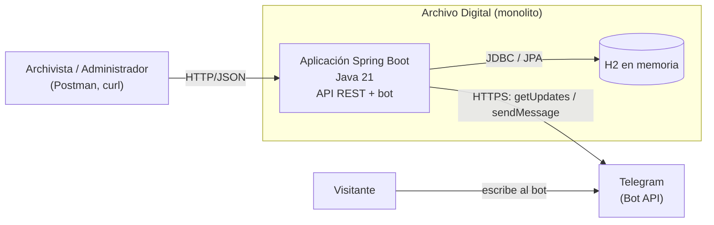
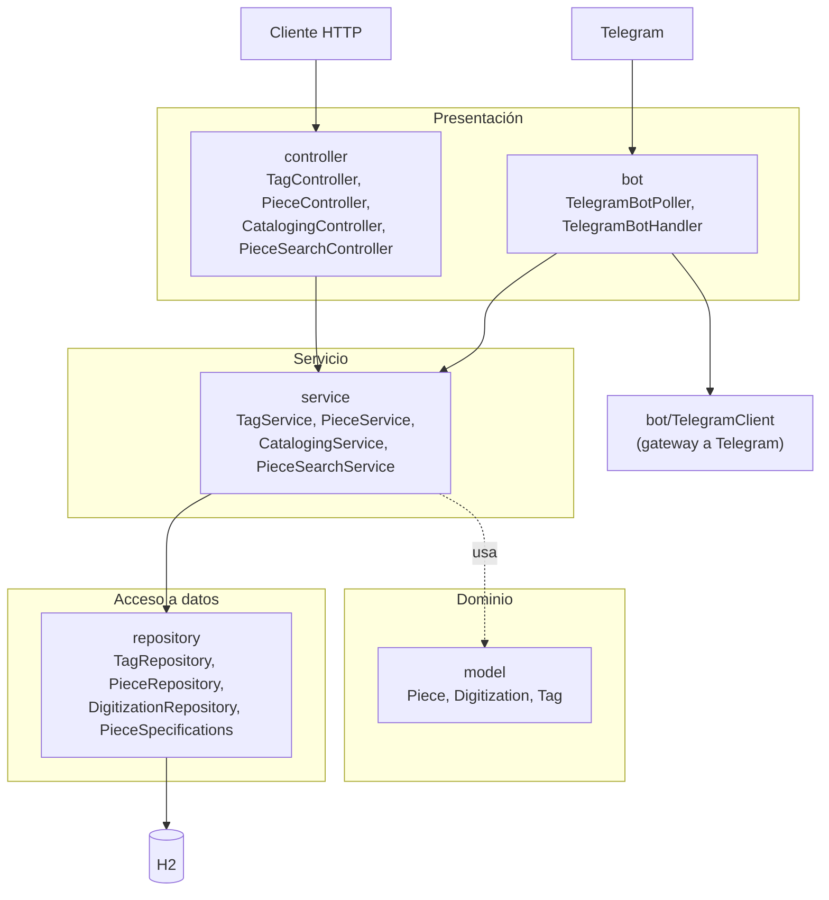

# Arquitectura

Monolito Spring Boot con una única base de datos. Más detalle (actores, alcance, glosario) en
[`ARCHITECTURE.md`](../ARCHITECTURE.md).

## Contenedores (C4 nivel 2)

El bot corre **dentro del mismo proceso**: la app le pregunta a Telegram cada pocos segundos si hay
mensajes nuevos (long polling). Por eso no necesita una URL pública ni un webhook, y funciona en una PC.

## Capas (Fowler)

| Capa            | Paquete                       | Responsabilidad                                                       |
| --------------- | ----------------------------- | --------------------------------------------------------------------- |
| Presentación    | `controller`, `bot`           | Traducir HTTP o un mensaje de Telegram a una llamada al service, y la respuesta a JSON o texto. |
| Servicio        | `service`                     | Orquestar: buscar entidades, aplicar reglas, persistir y mapear a DTO. |
| Dominio         | `model`, `model/exceptions`   | Entidades y reglas de negocio.                                        |
| Acceso a datos  | `repository`                  | Consultas a la base con Spring Data JPA.                              |
| Transversal     | `dto`, `exception`            | Objetos de transporte y traducción de errores a HTTP.                 |

`TelegramBotHandler` cumple para el bot el mismo papel que un controller para la API REST: no tiene
lógica de negocio, solo llama a `PieceSearchService` y `PieceService` y arma el texto de respuesta.
`TelegramClient` es un *gateway*: encapsula la comunicación HTTP con un sistema externo.
