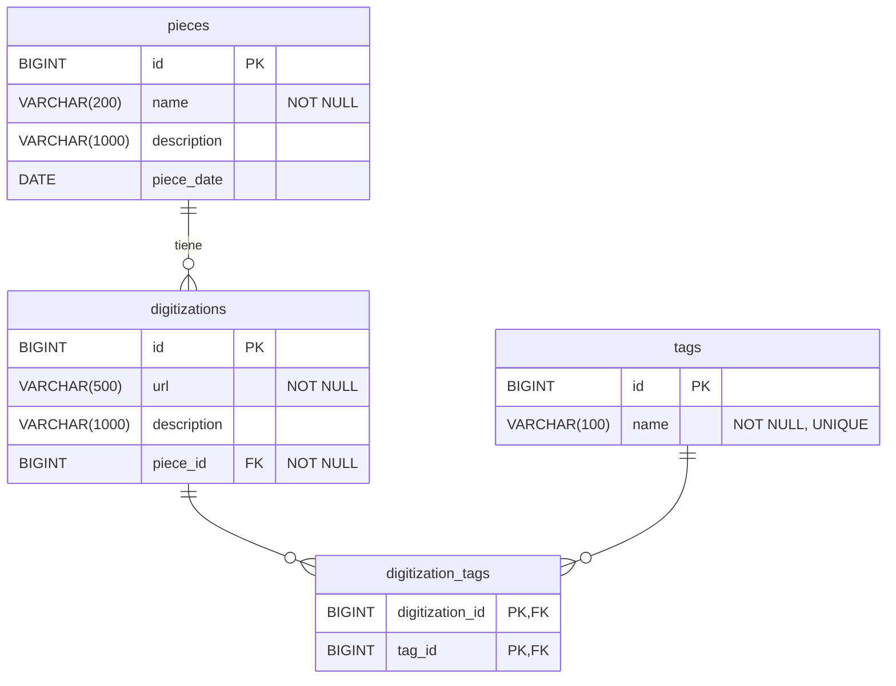

# Diagrama de base de datos

Base H2 en memoria. Las tablas las genera JPA (Hibernate) a partir de las entidades.

| Tabla               | Entidad / relación                           | Notas                                                         |
| ------------------- | -------------------------------------------- | ------------------------------------------------------------- |
| `pieces`            | `Piece`                                      | La columna es `piece_date` porque `date` es un tipo de SQL.   |
| `digitizations`     | `Digitization`                               | `piece_id` es la FK a la pieza (lado dueño de la relación 1 a N). |
| `tags`              | `Tag`                                        | `name` único: lo garantiza la base además del service.        |
| `digitization_tags` | Relación N a M entre `Digitization` y `Tag` | Tabla intermedia, sin entidad propia.                         |

La búsqueda por tags recorre `tags → digitization_tags → digitizations → pieces` con una subconsulta
`EXISTS` por cada tag pedido, así una pieza aparece una sola vez aunque varias digitalizaciones
coincidan.
