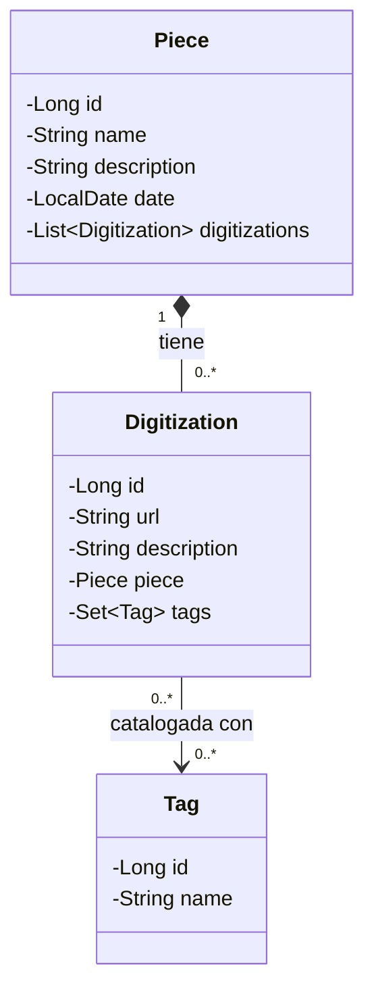

# Diagrama de clases de dominio

Las tres entidades del paquete `model`. Los atributos son los que se persisten.

- **Composición Piece → Digitization**: una digitalización no existe sin su pieza; se guarda y se
  borra junto con ella (`cascade = ALL`, `orphanRemoval = true`).
- **Asociación Digitization → Tag (N a M)**: la navegación es en un solo sentido. `Tag` no conoce las
  digitalizaciones; para saber si un tag está en uso se consulta desde `TagRepository`.
- Los tags se asignan a digitalizaciones, pero la búsqueda devuelve piezas: una pieza "tiene" un tag si
  alguna de sus digitalizaciones lo tiene.
