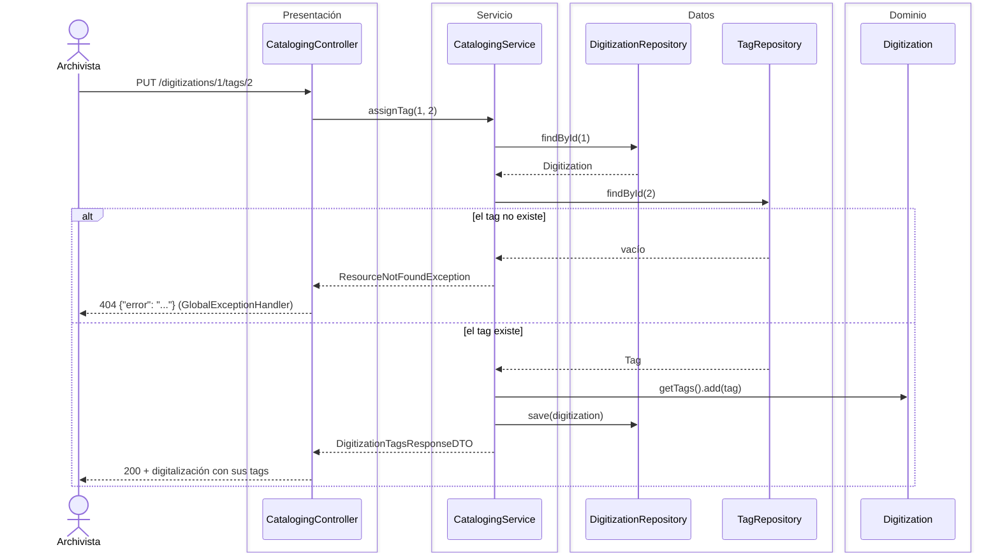
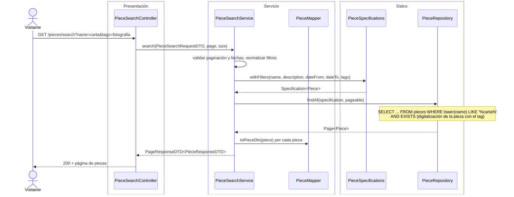
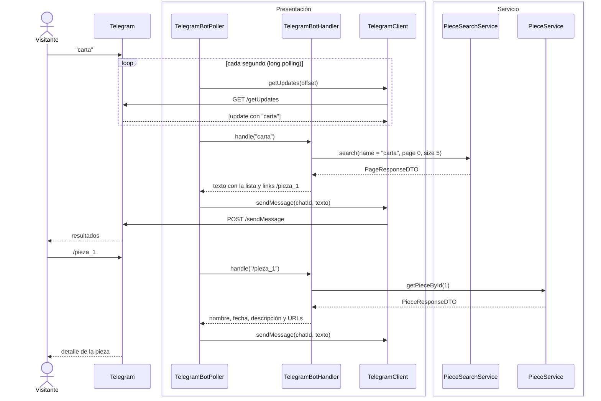

# Diagramas de secuencia

Cada participante está marcado con su capa: **[Presentación]**, **[Servicio]**, **[Datos]** y
**[Dominio]**.

## 1. Catalogar una digitalización (US-10)

`PUT /digitizations/{digitizationId}/tags/{tagId}`

## 2. Buscar piezas (US-12 a 14)

`GET /pieces/search?name=carta&tags=fotografia`

## 3. Consultar desde Telegram (US-15 y 16)

